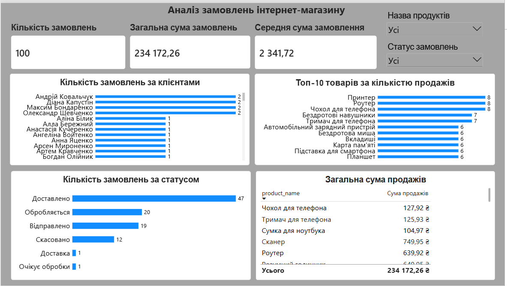
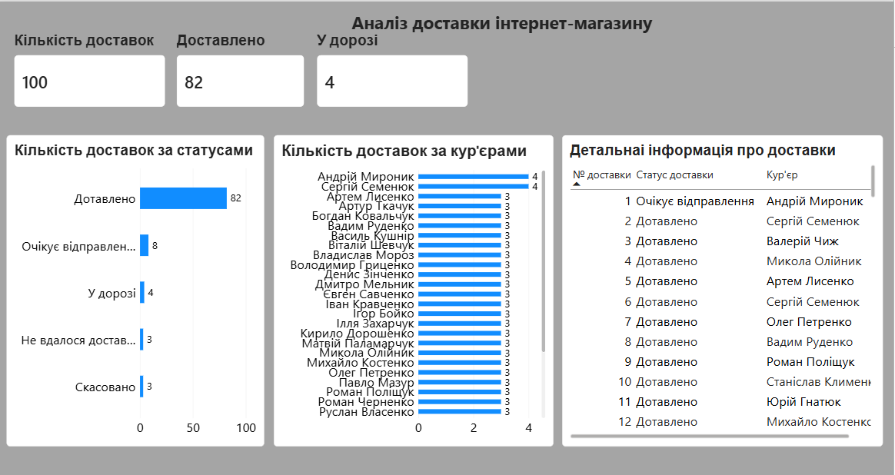
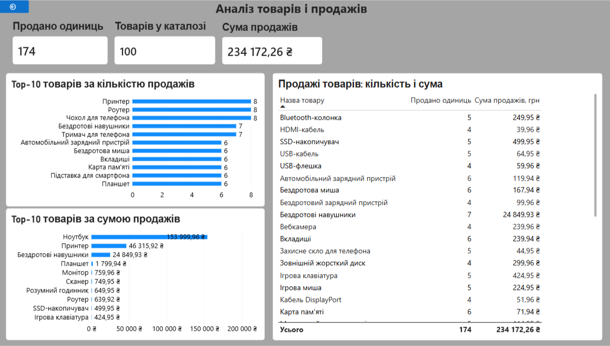

# Система керування замовленнями та доставкою інтернет-магазину — Power BI

## Опис проєкту

Проєкт являє собою інтерактивний звіт Power BI для аналізу замовлень інтернет-магазину, доставок і продажів товарів.

Звіт створено на основі даних реляційної бази даних, розробленої за допомогою SQL.

## Сторінки звіту

### 1. Аналіз замовлень інтернет-магазину
- Загальна кількість замовлень
- Загальна сума продажів
- Середня сума замовлення
- Кількість замовлень за клієнтами
- Кількість замовлень за статусами
- Топ-10 товарів за кількістю продажів
- Аналіз продажів товарів

### 2. Аналіз доставок магазину
- Загальна кількість доставок
- Кількість доставлених замовлень
- Кількість доставок за статусами
- Аналіз роботи кур'єрів

### 3. Аналіз товарів
- Загальна кількість проданих одиниць
- Кількість товарів у каталозі
- Загальна сума продажів
- Найпопулярніші товари
- Обсяг продажів за товарами

## Інструменти та технології

- Microsoft Power BI Desktop
- SQL
- SQLite
- Power Query
- DAX

## Основні можливості

- Інтерактивні фільтри
- KPI-картки з ключовими показниками
- Діаграми та таблиці
- Модель даних із пов'язаними таблицями
- Аналіз продажів і доставки замовлень

## Мета проєкту

Мета проєкту — продемонструвати практичні навички моделювання даних, створення інтерактивних звітів і проведення аналітики бізнес-показників.

## Автор

Навчальний проєкт для портфоліо Junior Data Analyst.

## Скріншоти звіту Power BI

### 1. Аналіз замовлень інтернет-магазину

### 2. Аналіз доставок магазину

### 3. Аналіз товарів

